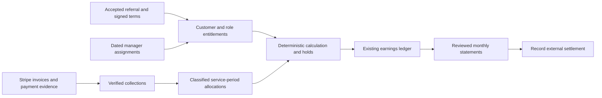

# Referral finance and client success: gap analysis and implementation plan

Prepared November 15, 2026 against source at `fec378a81ec799358546998b0bb2a2393b3c2905`. **Planning only.** This review inspected local code, migrations, test definitions and the authorized local private reference pack. It did not query production customer balances, verify deployed behavior, run application tests, activate agreements or connect a payment account.

## Recommended direction

**Later November 15 sequencing decision:** the owner asked to leave Stripe account setup/connection to Jeffrey until the software is ready. The [commercial preparation checkpoint](COMMERCIAL_PREPARATION.md) records the first implemented foundation and remaining releases. Build/test billing against local fixtures first; provider-backed sandbox/live acceptance remains the final activation gate. The phase table below preserves the original analysis, with its account-setup prerequisite superseded by this ordering.

Extend the existing relationship workspace, partner ledger, Services and My day. The ledger already has useful finance permissions, agreement versions, source deduplication, integer calculations, reversals and reviewed statements. The missing foundation is **verified customer collections, accepted referral attribution and dated role eligibility**. Adding percentage fields or connecting a payment webhook alone would not implement the proposed program correctly.

Use **Stripe Payments, Invoicing and Billing as the first billing integration**. The owner initially proposed signing up for Square, then requested whichever provider best fits this system. The comparison below favors Stripe for API-operated recurring services and bank payments. This is a design recommendation, not an account signup or a claim that either provider is connected. Keep a small provider adapter boundary; do not build two integrations initially.

Use deterministic code for money and eligibility. The employee assistant can explain records, prepare invoice proposals and identify exceptions. It must not infer cleared payments, invent commercial terms or decide compensation eligibility from conversation sentiment.

Actual commercial rates, durations, named allocation policies and agreement contents remain in private storage. The ignored local supplement `docs/private/referral-program/06_CRM_GAP_ANALYSIS_PRIVATE_2026-11-15.md` maps those draft requirements to this plan. Neither private drafts nor this report activate contractual rights.

## Billing provider decision

Research checked official documentation on November 15, 2026. These are current product capabilities; implementation must pin and test the selected API version.

| Need | Stripe | Square | Assessment for this CRM |
| --- | --- | --- | --- |
| Recurring managed-service billing | Subscriptions generate invoices and manage payment attempts and subscription states. [Subscription lifecycle](https://docs.stripe.com/billing/subscriptions/overview) | Subscriptions API supports recurring products/services through plans and variations. [Subscriptions API](https://developer.squareup.com/docs/subscriptions-api/overview) | Both support recurring services. Stripe's invoice/subscription lifecycle is a good fit for the proposed billing records. |
| Recurring bank payments through our software | ACH Direct Debit is reusable, requires customer authorization and has delayed confirmation. [ACH documentation](https://docs.stripe.com/payments/ach-direct-debit) | Subscriptions API does not support ACH. Invoices API cannot configure automatic bank-on-file payments. [Subscriptions limitations](https://developer.squareup.com/docs/subscriptions-api/overview), [Invoices limitations](https://developer.squareup.com/docs/invoices-api/overview) | This is the main reason to choose Stripe for recurring B2B services. Do not confuse Square dashboard features with API support. |
| Staff/assistant prepares invoices | Dashboard and API support invoice creation/editing, with separate draft and finalized states. [Invoice lifecycle](https://docs.stripe.com/invoicing/overview) | Invoices API can manage invoices for orders, but cannot create recurring invoice schedules or estimates; recurring subscriptions use a different API. [Invoices API](https://developer.squareup.com/docs/invoices-api/overview) | Stripe fits the proposed draft, review and issue flow. Provider actions still need precise authorization. |
| Existing invoice app with minimal custom work | Available through Stripe's dashboard. [Invoice lifecycle](https://docs.stripe.com/invoicing/overview) | Square Free offers invoicing without a monthly software subscription; processing charges apply. [Square pricing](https://squareup.com/us/en/invoices/pricing) | Square remains reasonable if the priority changes to mainly operating its own invoicing app. That is different from this API-focused requirement. |
| Proof of collection | Payment and balance records must be reconciled; pending and available balances are distinct. [Balance transactions](https://docs.stripe.com/reports/balance-transaction-types) | A separate adapter and reconciliation policy would also be required. | Neither provider substitutes for our referral eligibility and allocation rules. |

**Cost tradeoff:** Stripe lists pay-as-you-go Billing at **0.7% of Billing volume**, in addition to payment processing. Standard listed US card processing is **2.9% + $0.30**; ACH Direct Debit is **0.8%, capped at $5**. One-off Invoicing Starter is **0.4% per paid invoice**; recurring invoices fall under Billing instead of adding that one-off invoicing fee. These are provider prices, not company commission terms. [Stripe Billing pricing](https://stripe.com/billing/pricing), [Invoicing fee explanation](https://support.stripe.com/questions/stripe-invoicing-pricing).

For illustration, a $1,000 recurring charge under those standard rates is approximately $36.30 by card or $12 by ACH, including Billing. This excludes optional products, taxes, international/conversion fees and custom arrangements. Stripe is recommended for integration fit, not guaranteed lowest cost. Verify the actual account pricing before activation; Square's pricing also differs by plan and payment channel. [Square pricing](https://squareup.com/us/en/invoices/pricing).

Start with ordinary company billing. Marketplace splitting, automated partner transfers and Stripe Connect are not prerequisites for collecting customer payments and recording manually settled commissions. Do not buy or activate additional financial products as part of this plan.

## Existing / partial / missing matrix

“Existing” means present in inspected source, not freshly verified in production. Code references name the relevant function or schema to remain useful as line numbers move.

| Area | Finding and source evidence | Required extension / risk |
| --- | --- | --- |
| Customer identity and conversion — existing | [`convertOpportunity`](../lib/sales/service.ts) links canonical businesses, clients, contacts and projects and reuses existing clients. [`relationshipIds`](../lib/relationships/service.ts) traverses explicit links. | Reuse these IDs for billing and attribution. A won opportunity or created client does not prove payment. A later project for the same client must not reset referral rights. |
| Introductions — partial | [`addIntroduction`](../lib/relationships/service.ts), [migration 0051](../db/migrations/0051_business_discovery.sql): partner-linked introduction notes across relationship records. | No submitted/accepted/rejected/disputed/expired lifecycle, acceptance evidence, conversion deadline or first-valid-source constraint. A note must not become an accepted paid referral by backfill. |
| Partner onboarding — partial | [`createPartner`, `createAgreement`, `changeAgreement`](../lib/partners/service.ts): partner records and draft/active/retired agreement versions. | Add executed-document references, approved effective dates, onboarding status and customer-specific entitlements. Keep raw tax/bank documents out of ordinary CRM notes. |
| Agreement rules — partial | [`agreementTermsSchema`](../lib/partners/contract.ts): structured rates, dates and basis; service eligibility, timing, duration and refund policy are text. | Add a typed, versioned recurring-program rule set. Keep document-based and other existing agreement types working. Do not parse free text into live financial authority. |
| Rights after agreement termination — missing | [`recordEarning`](../lib/partners/service.ts) requires the agreement to be currently active and checks source date against its dates. | Separate closing an agreement to new referrals from rights retained for already accepted customers and late collections. Retiring an agreement cannot silently extinguish those rights in the new program. |
| Role separation — missing | [Migration 0064](../db/migrations/0064_relationship_operating_model.sql) requires `partner_id` on agreements, earnings and statements. | Internal originator and manager recipients need their own identities and dated eligibility. Do not create fake external partners for employees or reuse deal owner/project owner as compensation authority. |
| Manager assignment — partial | [`setAccountManager`](../lib/relationships/service.ts) updates `clients.account_manager_user_id` and audits the new value; active editing teammates can use it. | Add effective-dated assignment history, reasons and authority checks. Every UI/assistant writer must use the same transition. Existing current assignments do not establish historical earned periods. |
| Customer billing / collections — missing | No customer invoice, collection or Stripe/Square integration was found in the inspected application/migrations. [`sales/data.ts`](../lib/sales/data.ts) reports opportunity values. | Build provider ingestion, explicit customer mapping, invoice-line classification, collection verification and reconciliation. Pipeline/won values and service cost estimates cannot fund commissions. |
| Revenue source facts — partial | [`sourceSchema`](../lib/partners/contract.ts), [`recordEarning`](../lib/partners/service.ts): document counts or non-document revenue; operator selects collected/invoiced basis and source reference. | The word “collected” is not payment evidence. Add receipt linkage, recurring/upfront/excluded classification, covered service dates and prepaid allocation. |
| Rounding and deduplication — existing foundation | [`earningCents`](../lib/partners/contract.ts) uses BigInt integer rounding. Source keys and original source/partner earnings have uniqueness checks; [`once`](../lib/relationships/transactions.ts) serializes actor/request retries. | Add provider-event and business-allocation uniqueness independent of actor/request UUID. Preserve cent conservation when splitting payments, periods and manager days. |
| Multiple commission roles — incompatible current assumption | [`recordEarning`](../lib/partners/service.ts) caps combined introducer allocations for a source and rejects a second original earning for the same partner/source. | New program needs separate authorized role caps and recipient segments. Do not represent each role as another competing introducer or duplicate the revenue source per recipient. |
| Refunds — partial | [`reverseEarning`](../lib/partners/service.ts) creates one full negative reversal; original earnings remain. | Add partial refund/credit/dispute adjustments tied to original service allocations, with cumulative limits. A full reversal plus corrected source is a manual legacy workflow, not sufficient payment-event reconciliation. |
| Statements — existing foundation | [`createStatement`, `changeStatement`](../lib/partners/service.ts): locked entry claims, snapshots, revisions, draft/review/approval/paid states and external settlement reference. | Extend to internal recipients, customer/period explanations, holds, delivery/dispute dates and reconciliation. The same finance manager can currently review and approve; independent approval is not enforced. Marking paid does not move money. |
| Finance access — existing foundation | [`access`, `changeFinanceAccess`, `changePartnerAccess`](../lib/partners/service.ts): workspace membership, finance read/manage, bounded partner access. | Extend explicit recipient-level authorization for internal statements. Existing partner grants require workspace membership; they are not a complete external portal. Do not treat a missing partner ID as finance-wide authorization. |
| Managed services — existing | [`client-services/service.ts`](../lib/client-services/service.ts), [migration 0066](../db/migrations/0066_client_services.sql): service owners, cadence, reviews, incidents, renewals and measured outcomes/costs. | Add account-wide client-success obligations and evidence. Service kind is not billing classification; service owner is not automatically commissioned account manager. |
| Responses and check-ins — partial | [`saveConversationWork`](../lib/conversations/service.ts) supports manual ownership/reminders. [`proactive-sources.ts`](../lib/assistant/proactive-sources.ts) uses activity timestamps for follow-ups. | No meaningful-human-response classifier, holiday-aware business deadline engine or complete client-success coverage. Outbound auto-replies and activity timestamps alone cannot satisfy performance standards. |
| Task destination — schema gap | [Migration 0015](../db/migrations/0015_call_follow_up_tasks.sql) requires exactly an opportunity or conversation source. [`getSalesToday`](../lib/sales/data.ts) and proactive opportunity-task reads join opportunities. | Add a client task target and update all readers/writers, retention and My day. Creating fake opportunities or a hidden second task queue would fragment work. |
| Employee alerts — reusable delivery, missing domain integration | [`notification-worker.ts`](../lib/assistant/notification-worker.ts), [migration 0053](../db/migrations/0053_employee_notifications.sql): opt-in verified SMS/push, caps, quiet hours and late permission checks. | Add client-success source identity, permissions and cancellation rules. Existing turn/action/reminder sources are not a general client-success outbox. Core deadlines must not depend on an employee's Assistant grant remaining active. |
| Performance and eligibility — missing | Service reviews/incidents provide some evidence; no notice/cure, protected-exception, eligibility interval or prospective reassignment workflow found. | Separate operational performance notices from financial eligibility decisions. A missed check-in must not automatically erase earnings. |
| Assistant finance — deliberately bounded | [`operating-model-changes.ts`](../lib/assistant/tools/operating-model-changes.ts) can prepare agreements, earnings/reversals and statements subject to finance checks. | Preserve the absence of tools for agreement activation, statement approval/settlement and finance-grant changes. Add billing reads and reviewed proposals through explicit services, not unrestricted provider API access. |
| Upfront project compensation — missing | Projects and sales conversion exist, but no approved closer/developer payout-budget workflow was found. | Add a separate project budget with actual participants, direct costs, approved amounts and revisions. No finalized formula is available; do not infer a percentage from recurring rules. |

## Target records and financial flow

### Identity, attribution and role history

- Retain existing CRM clients, partners and introductions. Add referral submission/decision records, explicit acceptance evidence, expiry/extension and dispute resolution. Match through canonical relationship IDs; suggest possible duplicates for human review rather than merge by email/name alone.
- One valid accepted external attribution per eligible customer, with documented exceptions only where approved private terms allow them. Model internal direct origination without requiring an external introduction. Keep partner recruiter, internal originator, closer, developers and manager distinct.
- Resolve referral conflicts before confirming a program-eligible conversion. Allow ordinary non-program CRM sales to continue, but hold program enrollment/earnings while attribution is disputed. Do not silently discard a competing submission.
- Introduce commission recipients linked to either a real partner or an internal user, with workspace-scoped identities and retained historical references after offboarding. A recipient record confers no application access.
- Customer entitlements reference the exact executed agreement/rule version, accepted source, eligibility dates and first qualifying cleared recurring payment. Preserve window anchors through renewals/expansions/replay. Corrections to a mistaken anchor require a reviewed versioned adjustment, not an automatic reset.
- Store manager assignment intervals and internal eligibility intervals separately. Use effective dates, actor, reason and evidence. Keep `clients.account_manager_user_id` as a compatible current-assignment projection. Guard overlapping assignments and all concurrent UI/assistant writes.
- Use configurable capacity, skills and availability for assignment suggestions; leadership confirms them. Do not hardcode named employees, treat round-robin as an entitlement or automatically move earned originator credit when management changes.

### Billing evidence and collections

First adapter: the company's own Stripe account, with server-held least-privilege credentials, distinct sandbox/live identity and workspace mapping. Use hosted payment collection so our CRM does not handle card or bank credentials. Use provider IDs plus explicit reviewed CRM mapping; customer email is a candidate match, not binding authority.

Add normalized invoices/line items, subscription/service associations, payments, credit notes/refunds/disputes, provider event receipts and reconciliation checkpoints. Capture customer, currency, gross amounts, taxes, discounts, fees, covered dates, classifications and evidence provenance. Preserve source versions and audited mapping corrections. Reject unsupported currencies into review rather than silently convert them.

Webhook processing should verify signatures against the raw body, durably store a scoped event ID, acknowledge promptly, then use a leased/retryable worker to retrieve canonical objects and process them. Handle duplicate/out-of-order events, pagination, outages and dead letters; periodically reconcile independently of webhooks. Stripe explicitly does not guarantee event order and documents duplicate delivery. [Webhook guidance](https://docs.stripe.com/webhooks).

Define collection as its own reviewed policy: payment succeeded, processor funds available and bank payout reconciled are different milestones. Store each separately. Proposed starting point is successful payment plus available processor balance, subject to finance approval of what the signed terms mean by cleared; if bank settlement is required, hold until verified payout/bank reconciliation. Do not use an `invoice.paid` notification alone as proof of fresh eligible cash. Zero-value invoices, credits and payments recorded outside the processor require separate evidence. Stripe exposes pending/available balance states, and ACH can fail or be disputed after initial processing. [Balance transactions](https://docs.stripe.com/reports/balance-transaction-types), [ACH timing and risks](https://docs.stripe.com/payments/ach-direct-debit).

An approved manual verified-collection path can bridge account setup or out-of-band payments. Require receipt/reference, amount, date, client, line/service allocation and reviewer; put missing evidence on hold. Deduplicate it against later provider imports so a manual receipt and its imported payment cannot pay twice.

Keep processor fees separate from contractual eligible revenue. Do not substitute net bank deposits for eligible recurring receipts or deduct fees unless approved terms expressly require it. Reconcile each payment to eligible recurring allocation, excluded lines, unapplied cash and adjustments. Payment-to-invoice allocations must cover partial payments, multiple payments and credits without assuming every invoice has one payment.

### Allocation, calculation and ledger reuse

Create receipt-to-line-to-service-period allocations, with stable business IDs independent of calculation version. Prepaid receipts remain deferred for future covered months; release allocations as the corresponding service periods become eligible. Late collection retains the original service period and eligibility evidence. Window boundaries, partial months and assignment proration must use one approved calendar convention.

Extend `crm_referral_sources` with a program discriminator and verified allocation linkage. For the new program, a source represents the eligible cash slice for a service period, shared by its authorized recipients. Zero, excluded and held amounts stay in reconciliation records rather than fabricated positive earnings sources.

Extend existing agreements, earnings and statements for typed recipients and program/role information. The current schema requires external partner IDs, so this is an **expand/backfill/compatibility migration**, not simply adding a table:

1. Add nullable recipient/program/rule/calculation references and new normalized tables; legacy behavior stays default.
2. Backfill structural identities for existing partners/rows only. Do not invent accepted referrals, executed documents, cleared collections, historical assignment dates or actual policy values.
3. Deploy readers/writers and authorization that explicitly handle external versus internal recipients. Keep legacy partner routes scoped to external records; do not pass a null partner into existing authorization helpers.
4. Only then relax external-partner-only constraints for typed internal records, with replacement checks and workspace foreign keys. Preserve required external partner identity for legacy/external rows. Preserve legacy unique indexes and introduce new-program business-key uniqueness for recipient/role/entitlement/period segments.
5. Keep the legacy introducer allocation rule on legacy records. Apply independent approved role caps and assignment proration to new-program entries. A person holding two legitimate roles receives separately explained components, not two copies of the source revenue.

Each calculation retains receipt/allocation ID, customer, service dates, collection dates, exact rule version, role, eligibility/assignment segments, rate snapshot, integer inputs, rounding result and algorithm version. A changed algorithm version is not a new entitlement key: replay must not create another earning. Changed facts produce a hold or an approved correcting entry.

Use integer/decimal-safe arithmetic throughout. Allocate cents deterministically with a documented residual rule, then round each authorized component once at its defined boundary. Manager transfer segments must conserve the total authorized manager component and never double-count a calendar day. Negative entries link to the affected original allocations; prevent combined refunds/credits/disputes from reversing the same cash twice. Dispute resolution can release a hold or append a compensating entry with its own provenance.

The existing services preserve original earnings through reversals, but this review did not establish database-wide append-only enforcement. Add suitable write restrictions and audit coverage for the new program; never claim historical immutability merely because a UI lacks an edit button. Define retention and client-deletion safeguards before adding financial foreign keys.

### Statements, budgets and reporting

Reuse the existing reviewed-statement lifecycle and settlement reference. Extend recipients, customer/service-month explanations, held/excluded amounts, adjustments, delivery evidence, dispute deadlines and overdue flags. Lock statement claims and totals transactionally; no entry may be claimed twice. Preserve paid snapshots. Adjust prior periods on a later statement rather than rewriting them. Handle zero/negative balances as credits/holds under an explicit policy, not negative cash transfers.

Initially keep external settlements manual. If partial settlements are needed, model individual settlement allocations before exposing that action; the current single paid/reference transition is not proof of partial-payment support. A separate reviewer/approver can be enforced for the new program if chosen, but is not currently guaranteed.

Upfront project budgets remain separate: actual closer/developers, approved amounts or explicitly approved formula, direct costs, revisions, completion/collection conditions and external settlement evidence. Leave unspecified formulas blank. Do not derive recurring commissions from project revenue or implement restricted executive compensation in this workstream.

Leadership views should distinguish booked opportunity value, verified collected recurring cash, deferred prepaid allocations, eligible/held/accrued commissions, approved/paid balances, expiring rights and client-success exceptions. MRR requires recurring contract schedules; it is not the sum of collected receipts. Company retained revenue is before other expenses and is not profit.

### Client success, tasks and the assistant

Build a deterministic business-calendar module using an explicit timezone, working hours, announced holidays and versioned policies. Existing Eastern-time helpers and voice working-hours logic are starting points, not a holiday-aware SLA engine. Model inbound requests/missed calls, a meaningful human response, check-ins, review cadence, issue escalation, logging deadlines, approved exceptions and notice/cure workflows. Record observed evidence and allow authorized correction; distinguish unknown evidence from failure.

Reuse service incidents/reviews and authorized Inbox/meeting evidence. Never copy restricted message bodies or private meeting content into a broadly visible scorecard. A service health review is not an automatic compensation eligibility decision. Performance cure and origination-inactivity cure are distinct rules and need separate deadlines and histories.

Extend `crm_tasks` to support client targets, update the exactly-one-target check, scoped access, retention, task detail, My day, exports and Assistant task reads. Search for all opportunity-only joins before release. Use stable obligation keys so repeated worker runs create one task per obligation and resolve/suppress it when completed, reassigned or exempted.

Run deadline generation in a durable workspace worker, independent of paid AI and individual Assistant OAuth sessions. Reuse notification delivery controls only after adding client-success sources and permission checks. Recheck assignment, evidence, membership, opt-in and task resolution immediately before sending generic employee alerts. Native push's Apple/device gates and the separate Mail deployment remain their own activation work; SMS does not authorize customer outreach.

Assistant rollout: billing/statement reads first; local draft invoice proposals next; permissioned provider draft creation after review; explicit issue/send/subscription actions only after their own tested approval contracts. Preview exact client, lines, currency, service dates, cadence, amount, due date, automatic-collection implications and recipient. Bind approval to that version and recheck changes. Default drafts must not auto-finalize, email or charge. Treat enabling a recurring subscription as approval for its disclosed future charge schedule, not an ordinary editable draft. Keep agreement activation, compensation decisions, grants, refunds and settlement outside initial assistant tools.

## Phased delivery and release gates

Effort labels are relative scope, not delivery promises. Each phase should be a focused verified release on `main`; recheck the current migration tip before choosing migration numbers. The inspected latest migration is `0068_omi_always_ready.sql`.

| Phase | Deliverable and dependencies | Completion gate |
| --- | --- | --- |
| 0 — policy and billing setup; small | Owner creates/verifies the selected Stripe account. Finance identifies executed agreement versions, approves collection/period semantics and confirms recipient authority. Review the private supplement's unresolved choices. Create sandbox configuration and synthetic fixtures. | Account identity/scopes and policy decisions recorded privately; no live postings, charges or seeded draft rates. This report completes analysis, not these activation gates. |
| 1 — attribution and dated roles; medium | Referral acceptance/disputes/expiry, typed recipients, customer entitlement placeholders and manager/eligibility history. Route all assignment writers through one service. Add separate draft upfront budgets. | Concurrent attribution/assignment and access tests pass; new assignments have history; legacy records remain intact; unverified historical records visibly held. Capture can operate before billing is connected. |
| 2 — Stripe import and reconciliation; large | Read-only invoice/subscription/payment/refund/dispute/balance ingestion, durable events, explicit client mapping, classified lines, verified collection and service-period allocation. Manual evidence bridge where needed. | Sandbox cases reconcile exactly to cash/allocation totals; duplicates/outages recover; live read-only pilot matches finance-reviewed provider evidence. No commission posting or outbound provider writes. |
| 3 — recurring calculation and statements; large | Compatible ledger migration, versioned deterministic calculations, customer windows, role caps, manager-day allocation, partial adjustments, recipient statements and exception views. Depends on phases 1–2. | Shadow results match reviewed examples and one representative full statement period, with zero unexplained cent differences. Finance explicitly approves a bounded cohort before posting. Preserve all legacy statements and rights. |
| 4 — client-success operations; medium/large | Client tasks, business calendars, human-response/check-in evidence, workload suggestions, separate notice/cure flows and generic employee alerts. Assignment foundation from phase 1; may be developed alongside phases 2–3. | Observe-only results reviewed against human examples, permissions and holiday/leave cases. Then enable opt-in employee reminders. No automated forfeiture, reassignment or customer messaging. |
| 5 — assistant billing assistance and scale; medium | Permissioned reads, exact-version draft proposals and reviewed Stripe actions; reconciliation explanations and visible job outcomes. Later assess external portal, e-sign and secure payee onboarding separately. | Sandbox approval/replay/authorization checks and approved live acceptance pass before each write capability. No arbitrary external-app control or automatic partner payouts added by implication. |

### Rollout, backfill and recovery

- Separate flags: program off/capture/shadow/posting; billing import disabled/read-only; client success off/observe/remind; assistant billing read/draft/write. Posting and provider writes stay off by default. Use per-workspace/cohort activation, not one global switch.
- Baseline existing current manager assignments at the authorized cutover with explicit unknown prior history. Import legacy partner identities mechanically; manually verify preexisting rights, receipt history and first qualifying payment before calculating new-program arrears. Do not use account signup or CRM creation date as the window anchor.
- Reconcile full source history needed for approved windows, or hold incomplete customers. Paginate ingestion and statements; existing bounded UI lists are not a complete import/export. The current statement builder caps entries per statement, so plan deterministic batching without dropping records.
- Monitor unmatched receipts, unclassified lines, missing service dates, webhook age, reconciliation drift, retry/dead-letter counts, held earnings, approaching deadlines and duplicate suppression. Expose last successful synchronization and stale-data indicators to finance.
- Rollback disables new posting, provider writes and reminders; preserve event ingestion where already enabled so recoverable evidence is not lost. Reprocess using stable business keys after fixing the cause. Never roll back by deleting earnings, changing paid statement snapshots or resetting window anchors.
- Validate backup/restore on an isolated database and verify old/new reader compatibility before deploying constraints. Record migration version, local checks and live pilot evidence separately in runbooks.

## Acceptance and regression plan

Future implementation checks, not tests run by this review. Use synthetic public fixtures with invented policy values; actual contract examples belong only in authorized private verification.

| Case | Required result |
| --- | --- |
| Monthly recurring receipt | Eligible cash traces through exact invoice line, service period, agreement version and authorized role to one earning per component. |
| Mixed upfront/recurring/tax/pass-through invoice | Only eligible collected recurring portions accrue. Excluded amounts and fees remain visible in reconciliation. |
| Partial payment / multiple payments / unapplied cash | Allocate only verified cash using the approved line allocation policy; conserve cents and prevent double consumption. |
| Annual/quarterly prepayment | Record cash once; release only eligible covered service periods as they occur. Future months do not pay at receipt. |
| Late payment / terminated agreement / staff departure | Evaluate historical earned periods and surviving rights; current agreement or membership status alone does not erase them. |
| Window boundary, renewal, expansion and leap date | Approved calendar boundaries hold; later projects, replay and upgrades do not restart the window. |
| Mid-period manager transfer, gap or overlapping edits | Calendar days belong to the correct effective assignment, unassigned shares remain unallocated, combined component stays within cap; conflicting writes fail visibly. |
| Direct internal origination / partner recruitment / two roles | Explicit supported role attribution works without fake partners; the same person may hold separately authorized components without duplicating cash. |
| Duplicate referral / affiliated business / extension | Correct acceptance and canonical customer scope; conflicts held; extension requires evidence; no unintended affiliate inheritance. |
| Out-of-order/replayed webhook / manual receipt later imported | One verified cash record and one business allocation; repeated event IDs, distinct events about the same object and concurrent actors cannot duplicate earnings. |
| Credit / partial refund / chargeback / dispute reversal | Adjust affected original periods once; preserve paid snapshots and cumulative cash limits; restored funds use documented compensating entries. |
| Pending/failed ACH / available balance / bank payout | Distinct states remain visible; configured collection gate controls accrual; later returns reconcile. |
| Closed/zero-value/credited invoice | Invoice status alone never creates fabricated collected revenue. |
| Same-month statements / concurrent approval / retry | Each earning is claimed once; snapshot revision/total checks hold; no duplicate settlement record. |
| Finance/recipient/workspace permissions | Non-finance, revoked, cross-workspace and other-recipient reads/writes fail; internal recipients do not leak through null partner IDs. |
| Holiday / DST / after-hours / protected leave | Approved business deadlines and distinct cure policies apply; auto-replies do not satisfy human response; missing evidence can be reviewed. |
| Client task / permission revocation / reassignment | Task appears in My day and authorized assistant reads; stale employee alerts are canceled; no private message content leaks. |
| Assistant invoice changes after approval | Stale approval fails; drafts do not finalize/send/charge; retries do not duplicate invoices or subscriptions. |
| Legacy regression | Existing document/invoiced agreements, partner access, full reversals, statement history, conversion, Inbox, services and handoffs retain supported behavior. |

Existing regression starting points: [operating-model integration tests](../lib/relationships/operating-model.integration.test.ts), [handoffs](../lib/relationships/handoffs.integration.test.ts), [sales conversion](../lib/sales/service.integration.test.ts), [conversation work](../lib/conversations/service.integration.test.ts), [proactive work](../lib/assistant/proactive.integration.test.ts), and [relationship browser coverage](../tests/reporting/relationships.spec.ts). The existing browser file is not a recurring-finance acceptance suite; add targeted end-to-end journeys when implementing.

## Decisions still needed before activation

The owner delegated provider selection; this plan selects Stripe first. The following are configuration/contract decisions, not reasons to stop preparing the plan:

- Actual verified merchant account, authorized integration owner, billing methods and executed agreements/effective dates.
- Meaning of cleared collection; service-period boundaries; partial-payment line allocation; rounding/day ownership; treatment of a fully reversed first qualifying payment; late collections and processor fees.
- Exact after-hours morning deadline and holiday authority; protected exceptions; performance and inactivity cure handling; approved assignment authority and historical cutover.
- Upfront budget formula or individually approved amounts; statement delivery channel, dispute handling and whether independent approval/partial settlements are required initially.
- Approved pilot customers and evidence access, followed by explicit financial activation. Do not seed named prospective partners or assumed recipient rights.

## Review evidence

The source audit covered the relationship/conversion services, partner contracts/services and schema, client services, conversation access/work, task targets/readers, assistant finance/proactive/notification boundaries and existing test definitions. The private supplement records detailed draft-policy mapping and unresolved ambiguities without publishing them. Official provider sources are linked beside the claims they support.

Documentation verification: all 132 local Markdown links across this report, the three updated current/handoff documents and the private supplement resolve. `git diff --check` passed, the new public report was checked for private policy values, and the private supplement is confirmed Git-ignored. The pre-existing `next-env.d.ts` change is outside this work. Application tests and live financial acceptance are intentionally not claimed for this documentation-only work. Follow [project status](PROJECT_STATUS.md), [the existing ledger guide](REFERRAL_LEDGER.md) and [the planning handoff](REFERRAL_CLIENT_SUCCESS_PLAN.md) when implementation starts.

## November 15 client-success implementation checkpoint

[Client success](CLIENT_SUCCESS.md) now implements versioned business calendars, explicit after-hours/holiday coverage, client obligations in existing CRM tasks/My day, personal cadence exceptions, human versus automatic response evidence, manager pool/capacity/availability and reviewed transfers. The deterministic worker uses the existing authenticated cron independently of AI, with default-off observation/reminder activation and individual employee opt-in. The assistant can read authorized operational evidence. This addresses the core client-success source gap; it does not automatically ingest private Inbox messages, infer performance forfeiture or activate financial rules. Read the runbook’s limits and production acceptance steps. Reviewed billing writes and remaining finance exceptions still precede Jeffrey’s provider connection.

## November 16 reviewed billing implementation checkpoint

[Invoice actions and recurring setup](STRIPE_INVOICE_ACTIONS.md) implement the core reviewed-provider-action portion of phase 5: customer identity linking, separate issue/send approvals, finite monthly schedules, exact source/provider revalidation and durable duplicate/uncertainty receipts. All provider gates remain off. Remaining lifecycle/settlement exceptions in the ledger runbook and actual provider acceptance are still open; this checkpoint does not complete financial rollout or activate actual terms.

## November 16 financial preparation completion

[Financial exceptions and settlement](FINANCIAL_EXCEPTIONS.md) supplies the core remaining phase-3 workflows: exact snapshot/review-bound closed-dispute and credit allocation, immutable original-window corrections, statement partial payments/offsets/reversals and delivery/dispute evidence. Default-off provider writes and posting are unchanged. [Jeffrey's current handoff](JEFFREY_STRIPE_SETUP.md) now moves to account setup, sandbox/permission/worker acceptance, private financial sign-off and a supported live pilot. Historical pending implementation statements above describe earlier checkpoints; unsupported source allocations, recipient self-service, exports and automatic payouts remain outside this bounded release.
